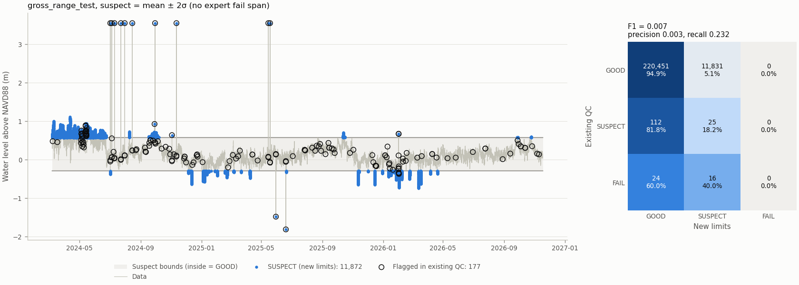
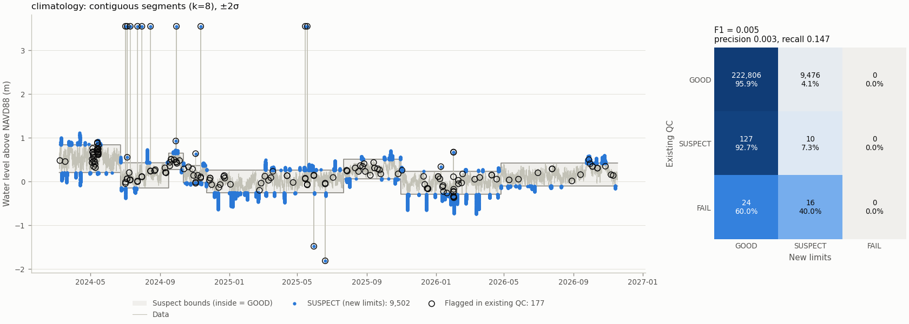
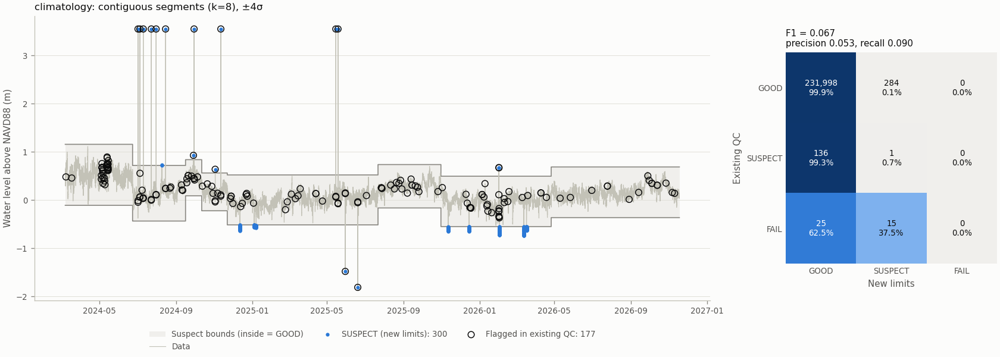
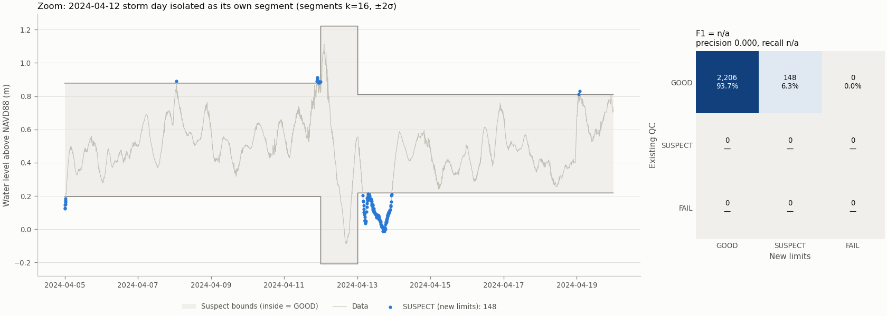

# build_limits: initial learning (2026-11-18)

First pass at `ioos_qc/build_limits.py`, following [handoff.md](handoff.md):
statistically derived **suspect** bounds for `qartod.gross_range_test`, and
`qartod.climatology_test` configs built from regimes found by clustering.
Fail bounds are intentionally left to manufacturers/experts.

**Summary**

* The workflow runs end to end on the Belhaven practice dataset. Gross range
  bounds, four climatology variants, QC runs, plots and F1 scores take ~6 s
  total.
* **Clustering finds real structure.** It picks out a high-water spring 2024,
  late-summer/autumn highs each year, lower winters, and isolates the
  2024-04-12 storm day as its own regime.
* **F1 against the existing QC is low for every option (≤ 0.11).** This mostly
  reflects the comparison, not the bounds. ±2σ marks ~4–5 % of any dataset as
  SUSPECT by construction, while the existing QC flags only 0.08 %, mostly
  spikes/flat lines *inside* the normal range that no range test can catch.
* With these data, clustered climatologies did **not** beat a plain
  calendar-month climatology on F1. Their value so far is interpretability
  (fewer, meaningful windows) and event detection, not accuracy.
* `n_std=2` is too tight for QC use here. 3–4 σ gives suspect rates
  (0.02–0.5 %) closer to what an operator would tolerate.

---

## 0. Changes made on 2026-11-18

In order:

1. **Pivot away from a trained-model approach.** The first plan
   (`auto_thresh.py`: train ML coefficients, export to JSON, apply with
   `range_thresh()`) was dropped and its code removed. Gross-range suspect
   limits only need statistics (mean ± n·σ), not ML.
2. **New module `ioos_qc/build_limits.py`**: `auto_thresh`, `find_regimes`,
   `climatology_config`, `compare_flags`, `plot_limits` (§1).
3. **Clustering methods chosen** after comparing k-means, Gaussian mixtures
   and contiguous agglomerative clustering on daily features (§1). The
   contiguous Ward clustering is implemented in numpy, so no scikit-learn
   dependency.
4. **Features clustered in physical units.** z-scoring each feature let
   noise in a near-constant feature dominate.
5. **`period` option for `seasonal`**: `"month"` (default), `"weekofyear"`,
   `"day_of_year"`, using the same names and ISO-week handling as
   `qartod.climatology_test`.
6. **`smooth` option for `seasonal`**: year-wrapping rolling mean over
   neighbouring calendar units before clustering. Defaults 1 / 3 / 15 for
   month / week / day.
7. Workflow script, results, figures and configs for the Belhaven practice
   data (§4).

---

## 1. What was built

`ioos_qc/build_limits.py` (no new dependencies: numpy, pandas, scipy; plotting
needs matplotlib):

| Function | What it does |
|---|---|
| `auto_thresh(data, n_std=2)` | Suspect span `(mean − n·σ, mean + n·σ)`, ignoring NaNs. No fail span. |
| `find_regimes(data, time, method=, n_regimes=, period=, smooth=)` | Clusters the record and returns the regimes as a table (date ranges, or one row per calendar unit for `seasonal`, with level and spread). Use it to see *when* seasons/storms occur before building a config. |
| `climatology_config(data, time, method=, n_regimes=, period=, smooth=, n_std=, fail_span=None, z=None, z_bins=None)` | Runs `auto_thresh` on each regime and returns a list of window dicts for `qartod.climatology_test` (JSON-serialisable). Optional expert `fail_span` is added to every window. Optional depth bins are clustered separately and get a `zspan`. |
| `compare_flags(reference, flags)` | Confusion matrix (GOOD/SUSPECT/FAIL) plus precision, recall and F1, where *flagged* = SUSPECT or FAIL. |
| `plot_limits(data, time, limits, reference=None, ...)` | Time series with the bounds (constant for gross range, stepped for climatology) and new flags. If `reference` flags are given, adds a confusion matrix and the F1 score. |

Tests: `tests/test_build_limits.py` (18 tests, synthetic data, no network).

### Clustering methods

All methods describe each day by two robust features: the **median level**
and the **5–95 % spread** (a calm day has a small spread; a storm, a large one).
Features are clustered in the variable's own units, so distances are physical.

| `method` | Algorithm | Output windows | Reusable on future data? |
|---|---|---|---|
| `segments` | Contiguous Ward clustering: adjacent days are merged bottom-up, always choosing the merge that adds the least within-group variance. Equivalent to scikit-learn's `AgglomerativeClustering(linkage="ward")` with a time-chain connectivity (checked in the tests), implemented in ~15 lines of numpy. | One window per segment, absolute dates | No – dates are specific to the record |
| `regimes` | k-means (scipy) on daily features, no time constraint. Days far apart can share a regime and its bounds. | One window per run of consecutive days (231 here) | No |
| `seasonal` | k-means on calendar-unit features pooled over years. Unit set by `period`: `"month"` (default), `"weekofyear"` (ISO week) or `"day_of_year"`. | Windows with that `period` | **Yes** – repeats every year |

Methods tried and set aside during exploration:

* **k-means / Gaussian mixture on days**: sensible regimes, but labels flip
  day to day (150–380 runs), giving hundreds of windows. Kept only as the
  `regimes` option.
* **Standardising the features** (z-scoring each feature) let a near-constant
  feature's noise dominate. In a synthetic test it grouped March with summer
  because of one storm. Clustering in physical units fixed this.

**Choice for now: `segments`** for describing/QC-ing a historical record (most
interpretable, isolates events). Use **`seasonal`** when the config must be
applied to new data (near-real-time streams).

### How `seasonal` works

It is **not** a sliding window, and a calendar unit's bounds do **not** come
from that unit alone:

1. Each day gets its median level and 5–95 % spread.
2. Days are pooled by calendar unit across years (every January together,
   every ISO week 3 together, every 15 Feb together, ...). That gives 12, 53
   or 366 points.
3. For weeks and days, each unit's features are smoothed with its neighbours
   (centred rolling mean that wraps around the new year; `smooth`, defaults
   1 month / 3 weeks / 15 days, `smooth=1` disables it). Without this, units
   averaged over only a few years are noisy and the clusters fragment:
   `day_of_year` gave 111 windows with a median length of 2 days on
   Belhaven, versus 15 windows with a median of 21 days when smoothed.
4. k-means groups the units into `n_regimes` groups. Groups need not be
   adjacent: Belhaven months grouped as {Jan}, {Feb, Dec},
   {Mar–Jun, Aug–Oct}, {Jul, Nov}.
5. `auto_thresh` runs on **all raw data from every unit in the group**, across
   all years. March's bounds, for example, use every observation from
   March–June and August–October.
6. Consecutive units in the same group become one window, e.g.
   `{"tspan": (3, 6), "period": "month", ...}`.

So **`period` sets the resolution of the window edges, not the number of
windows**. `period="day_of_year"` with the default `n_regimes=8` gives about 21
windows on Belhaven (8 distinct suspect spans), not 366. With
`n_regimes` = number of units and `smooth=1`, every unit becomes its own
group. For months that equals a plain calendar-month climatology. For days
it gives noisy bounds from 2–3 days of data each.

---

## 2. Usage

```python
import pandas as pd

from ioos_qc import qartod
from ioos_qc.build_limits import auto_thresh, climatology_config, compare_flags, find_regimes, plot_limits

# Load the practice data (CSV from the ERDDAP link in handoff.md; row 2 holds units)
df = pd.read_csv("docs/design/data/belhaven-nc.csv", skiprows=[1], parse_dates=["time"])
water_level = df["water_surface_above_navd88"].to_numpy()          # m, NAVD88
time = df["time"].dt.tz_convert("UTC").dt.tz_localize(None)        # Series, naive UTC
existing_qc = df["water_surface_above_navd88_qc_agg"].to_numpy()   # aggregate QARTOD flags

# Gross range: suspect from the data, fail from the manufacturer/experts
suspect = auto_thresh(water_level, n_std=3)
flags = qartod.gross_range_test(water_level, fail_span=(-3.0, 4.0), suspect_span=suspect)

# What regimes are in the record?
find_regimes(water_level, time, method="segments", n_regimes=16)

# Climatology config from those regimes
cfg = climatology_config(water_level, time, method="seasonal", period="month",
                         n_regimes=4, n_std=3, fail_span=(-3.0, 4.0))
# or period="weekofyear" / "day_of_year" for finer window edges
flags = qartod.climatology_test(cfg, water_level, time)

# Compare with existing QC and plot
compare_flags(existing_qc, flags)["f1"]
fig = plot_limits(water_level, time, cfg, reference=existing_qc, ylabel="Water level (m)")
```

(The `fail_span` values above are placeholders, not recommendations.)

Notes:

* Times may be tz-aware; they are converted to UTC and written to the config
  as tz-naive ISO strings. **`qartod.climatology_test` itself fails on a
  tz-aware `DatetimeIndex`** (`mapdates` calls `.dt` on it). Pass a tz-aware
  `pandas.Series` or naive times. This is an existing ioos_qc issue, not
  changed here.
* `n_regimes` controls granularity. For `segments`, the storm day only
  separates out at k ≥ 12; a second event (2026-03-12) appears at k = 20.
* `climatology_config` is a different function from
  `qartod.climatology_config` (that one validates a config). The new one
  builds one, and its output passes the validator.
* Reproduce everything below: `PYTHONPATH=. python docs/design/scripts/run_belhaven.py`.
  The `qc` conda env has a non-editable ioos_qc installed, so `PYTHONPATH=.`
  (or `pip install -e .`) is needed for scripts to see this module.

---

## 3. Practice dataset

SECOORA ERDDAP `belhaven-nc`: `water_surface_above_navd88` (m) with
`water_surface_above_navd88_qc_agg`. 232,459 samples at ~6 min,
2024-03-06 → 2026-11-17.

Existing QC (`qc_agg`) flags **177 points (0.08 %)**: 137 SUSPECT and 40 FAIL.
These include 10 stuck values at 3.548 m and two dropouts (−1.81, −1.48 m),
but most are spike, rate-of-change or flat-line flags at ordinary water levels.

---

## 4. Results

### 4.1 Regimes found

`segments`, k = 16:

| Start | End | Days | Median level (m) | Spread (m) | Interpretation |
|---|---|---|---|---|---|
| 2024-03-06 | 2024-04-12 | 36 | 0.54 | 0.32 | high-water spring 2024 |
| **2024-04-12** | **2024-04-13** | **1** | 0.49 | **1.12** | **storm day** |
| 2024-04-13 | 2024-06-23 | 68 | 0.51 | 0.27 | spring 2024 (cont.) |
| 2024-06-23 | 2024-08-08 | 46 | 0.07 | 0.20 | early summer low |
| 2024-08-08 | 2024-09-16 | 39 | 0.22 | 0.18 | late summer |
| 2024-09-16 | 2024-10-12 | 26 | 0.46 | 0.18 | autumn high |
| 2024-10-12 | 2024-11-22 | 41 | 0.17 | 0.18 | late autumn |
| 2024-11-22 | 2025-02-28 | 98 | −0.06 | 0.19 | winter |
| 2025-02-28 | 2025-07-22 | 144 | 0.05 | 0.22 | spring/early summer 2025 |
| 2025-07-22 | 2025-10-31 | 99 | 0.29 | 0.17 | late-summer/autumn high |
| 2025-10-31 | 2026-01-11 | 72 | −0.01 | 0.20 | early winter |
| 2026-01-11 | 2026-02-02 | 22 | −0.18 | 0.25 | mid-winter low |
| 2026-02-02 | 2026-04-26 | 83 | 0.00 | 0.21 | late winter/spring |
| 2026-04-26 | 2026-09-24 | 151 | 0.12 | 0.19 | summer |
| 2026-09-24 | 2026-11-03 | 40 | 0.33 | 0.17 | autumn high |
| 2026-11-03 | 2026-11-17 | 15 | 0.12 | 0.17 | — |

`seasonal`, k = 4, grouped months as: {Jan}, {Feb, Dec}, {Mar–Jun, Aug–Oct},
{Jul, Nov}. Jan/Dec/Feb as "low winter" is sensible. Jul and Nov grouping
together, apart from their neighbours, is a k-means artefact of having only 12
points and ~2.7 years. More years would stabilise it.

`seasonal` by `period` (k = 4, ±3σ, all data):

| `period` | `smooth` | Windows | Median window length | % flagged | F1 |
|---|---|---|---|---|---|
| `month` | – | 7 | 1 month | 0.45 | 0.033 |
| `weekofyear` | 1 (off) | 19 | 2 weeks | 0.90 | 0.016 |
| `weekofyear` | 3 (default) | 11 | 3 weeks | 0.86 | 0.017 |
| `day_of_year` | 1 (off) | 111 | 2 days | 0.63 | 0.022 |
| `day_of_year` | 15 (default) | 15 | 21 days | 0.77 | 0.018 |

With < 3 years of data, finer periods don't beat `month` on F1. They should
pay off with longer records, where each week/day has more years behind it.

### 4.2 QC comparison: all data

Flagged = SUSPECT or FAIL by the new limits. TP/FP/FN are measured against
`qc_agg` (177 flagged points). No expert fail span was supplied, so the new
limits only produce SUSPECT.

| Limits | n_std | Windows | Flagged | % flagged | TP | FP | Precision | Recall | **F1** |
|---|---|---|---|---|---|---|---|---|---|
| gross range | 2 | 1 | 11,872 | 5.11 | 41 | 11,831 | 0.003 | 0.232 | 0.007 |
| gross range | 3 | 1 | 1,208 | 0.52 | 16 | 1,192 | 0.013 | 0.090 | 0.023 |
| gross range | 4 | 1 | 34 | 0.015 | 12 | 22 | 0.353 | 0.068 | **0.114** |
| calendar months (no ML) | 2 | 12 | 9,498 | 4.09 | 26 | 9,472 | 0.003 | 0.147 | 0.005 |
| calendar months (no ML) | 4 | 12 | 218 | 0.094 | 16 | 202 | 0.073 | 0.090 | 0.081 |
| segments k=8 | 2 | 8 | 9,502 | 4.09 | 26 | 9,476 | 0.003 | 0.147 | 0.005 |
| segments k=8 | 4 | 8 | 300 | 0.129 | 16 | 284 | 0.053 | 0.090 | 0.067 |
| segments k=16 | 2 | 16 | 8,696 | 3.74 | 24 | 8,672 | 0.003 | 0.136 | 0.005 |
| segments k=16 | 4 | 16 | 367 | 0.158 | 16 | 351 | 0.044 | 0.090 | 0.059 |
| regimes k=4 | 2 | 231 | 8,914 | 3.84 | 26 | 8,888 | 0.003 | 0.147 | 0.006 |
| regimes k=4 | 4 | 231 | 421 | 0.181 | 16 | 405 | 0.038 | 0.090 | 0.054 |
| seasonal k=4 | 2 | 7 | 9,577 | 4.12 | 37 | 9,540 | 0.004 | 0.209 | 0.008 |
| seasonal k=4 | 4 | 7 | 241 | 0.104 | 15 | 226 | 0.062 | 0.085 | 0.072 |

(3σ rows and full scores are in `docs/design/data/results.json`.)

### 4.3 QC comparison: built before 2025-07-01, applied after

A check of how configs behave on "future" data:

| Limits | n_std | % flagged | TP / 66 | F1 |
|---|---|---|---|---|
| gross range | 2 | 0.83 | 3 | 0.006 |
| gross range | 4 | 0.00 | 0 | – |
| calendar months (no ML) | 2 | 4.28 | 9 | 0.003 |
| calendar months (no ML) | 4 | 0.16 | 3 | 0.024 |
| seasonal k=4 | 2 | 1.92 | 9 | 0.008 |
| seasonal k=4 | 4 | 0.12 | 3 | 0.029 |

`seasonal` pools several months per window, so its bounds are estimated from
more data. On new data it flagged less than half as much as calendar months
at 2σ, catching the same number of reference flags.

### 4.4 Figures

Gross range, ±2σ. The stuck 3.548 m values and the two dropouts are caught
(blue inside a black ring = flagged by both). But ±2σ also flags the whole
high-water spring of 2024 and every winter low.



Climatology from contiguous segments (k = 8), ±2σ. Bounds step with the
seasons, so flags are spread more evenly through the year. F1 is no better,
because the reference flags are mostly spikes.



Same at ±4σ:



Storm day zoom (segments k = 16). The storm gets its own wide window, so the
storm itself is GOOD. Segments are built from whole days, though, so the
setdown recovery after midnight on 04-13 falls into the next (tighter) window
and is flagged.



Also generated: `clim_calendar_months_2std.png`, `clim_regimes_k4_2std.png`,
`clim_seasonal_k4_2std.png`.

---

## 5. What we learned

1. **The F1 comparison needs care.** Existing `qc_agg` flags mix all QARTOD
   tests. Gross range/climatology can only catch values outside a range, so
   recall is capped (~23 % at best here). To judge range bounds fairly,
   compare against the gross-range or climatology flags alone. Some ERDDAP
   datasets publish these as `*_qc_tests`, one digit per test.
2. **±2σ ≈ 5 % suspect, always.** For roughly normal data, that fraction is
   fixed by the choice of `n_std`, not the data quality. Precision will be
   tiny against sparse manual flags. `n_std` is effectively the "how many
   suspects can I tolerate" knob: here 3σ flags 0.3–0.6 % and 4σ
   0.02–0.2 %, depending on the method.
3. **Mean/σ are pulled by bad data.** The 3.548 m stuck values and dropouts
   are included when computing σ. Options: compute bounds on GOOD-flagged
   data only when flags exist, or use median/MAD.
4. **Clustering finds physically meaningful regimes** (seasons, a storm) with
   just two daily features. But with 2.7 years, any data-driven climatology is
   only as good as the years it has seen.
5. **Storm windows explain storms away.** Giving a storm its own window makes
   storm values GOOD. That's reasonable for real events, but a sensor fault
   with a large spread would be "explained away" the same way. Event
   segments are better used to *report* events than to widen bounds blindly.
6. **Daily resolution clips events** at midnight (see zoom). A finer `freq`
   (e.g. `"6h"`) or padding event segments would help.
7. **Absolute-date configs don't transfer.** Only `seasonal` (any `period`)
   produces a config usable on new data.
8. **Finer calendar units need smoothing or more years.** Day-of-year and
   week-of-year features from 2–3 years are noisy; without smoothing the
   clusters fragment into many tiny windows with unstable bounds.

---

## 6. Future work

* Fairer scoring: decode the gross-range digit of `*_qc_tests` where
  available and compare like with like.
* Exclude flagged data (or use median/MAD) when computing bounds.
* Choose `n_regimes` automatically (e.g. elbow on within-segment variance /
  BIC) instead of by hand.
* Event handling: finer `freq`, padding around short segments, and an option
  to report events without widening their bounds.
* Seasonal configs from longer records (5–10+ years), where `weekofyear` /
  `day_of_year` should outperform `month`.
* Optional no-clustering mode (`n_regimes=None`): one window per calendar
  unit, bounds from data pooled over a moving window of neighbouring units.
  This would give a classic day-of-year climatology.
* Depth: `z_bins` is implemented and tested on synthetic data but not yet on a
  real profiling dataset.
* Try other stations/variables (temperature, salinity) to see whether the
  method and default `n_std` generalise.

## Appendix: files

| Path | Contents |
|---|---|
| `ioos_qc/build_limits.py` | Module |
| `tests/test_build_limits.py` | 18 unit tests |
| `docs/design/scripts/run_belhaven.py` | Workflow run on the practice dataset |
| `docs/design/data/belhaven-nc.csv` | Practice data (~8 MB) |
| `docs/design/data/configs/*.json` | Generated climatology configs (per method and n_std) |
| `docs/design/data/results.json` | All scores |
| `docs/design/figures/*.png` | Figures |
